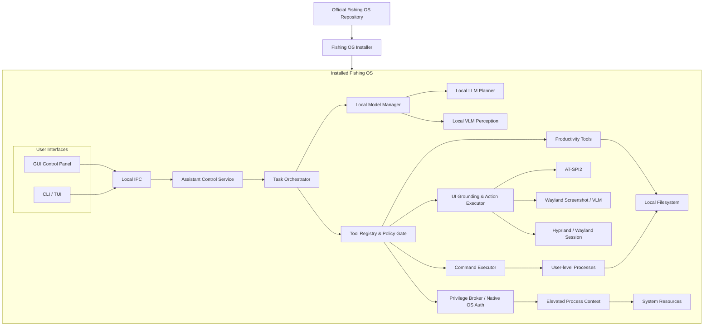

# Fishing OS — Computer-Use Assistant

## Software Requirements Specification (SRS)

**Versi:** 1.2 — Final Audited Baseline  
**Tanggal:** 21 November 2026  
**Status:** Baseline final untuk perancangan dan implementasi  
**Produk induk:** Fishing OS  
**Jenis fitur:** Fitur AI sistem operasi yang opsional saat instalasi  
**Target distribusi:** Fishing OS yang dipasang ke disk; tidak disertakan pada Live ISO  
**Bahasa:** Bahasa Indonesia

---

## Kendali Dokumen

| Atribut | Nilai |
|---|---|
| Nama dokumen | Software Requirements Specification — Fishing OS Computer-Use Assistant |
| Versi | 1.2 — Final Audited Baseline |
| Tanggal | 21 November 2026 |
| Status | Baseline final kebutuhan produk dan persyaratan teknis tingkat sistem |
| Produk induk | Fishing OS |
| Pemilik fitur | Fishing OS Project |
| Jenis distribusi | Paket resmi Fishing OS; bukan aplikasi lintas-distro |
| Ketersediaan pada Live ISO | Tidak tersedia dalam bentuk apa pun |
| Ketersediaan pada instalasi disk | Opsional; dipilih pengguna saat instalasi atau dipasang setelahnya |
| Bahasa dokumen | Bahasa Indonesia |

### Riwayat Perubahan

| Versi | Tanggal | Perubahan |
|---|---|---|
| 1.0 | 21-11-2026 | Menetapkan Assistant sebagai fitur resmi Fishing OS yang opsional pada instalasi ke disk; dikeluarkan sepenuhnya dari Live ISO; menetapkan strategi hybrid model, GUI dan CLI/TUI, serta prioritas capability-first. |
| 1.1 | 21-11-2026 | Menambahkan kapabilitas pengelolaan perangkat secara luas, eksekusi perintah lokal, akses administratif melalui sudo/Polkit dan privilege mediation, serta persyaratan autentikasi, persetujuan, pembatalan, dan audit tindakan privileged. |
| 1.2 | 21-11-2026 | Audit konsistensi persyaratan dan arsitektur; memperjelas kontrak command execution, batas kewenangan lokal, model otorisasi Administrator Mode, perilaku shell/interactive command, pembatalan operasi, acceptance criteria, serta metadata dokumen. |

---

## Daftar Isi

1. [Pendahuluan](#1-pendahuluan)
2. [Deskripsi Umum Produk](#2-deskripsi-umum-produk)
3. [Arsitektur dan Desain Sistem](#3-arsitektur-dan-desain-sistem)
4. [Persyaratan Antarmuka Eksternal](#4-persyaratan-antarmuka-eksternal)
5. [Persyaratan Fungsional](#5-persyaratan-fungsional)
6. [Persyaratan Data](#6-persyaratan-data)
7. [Persyaratan Non-Fungsional](#7-persyaratan-non-fungsional)
8. [Keamanan, Keselamatan, dan Privasi](#8-keamanan-keselamatan-dan-privasi)
9. [Persyaratan Distribusi, Paket, dan Installer](#9-persyaratan-distribusi-paket-dan-installer)
10. [Strategi Verifikasi dan Pengujian](#10-strategi-verifikasi-dan-pengujian)
11. [Kriteria Penerimaan](#11-kriteria-penerimaan)
12. [Tahapan Implementasi](#12-tahapan-implementasi)
13. [Ketergantungan, Risiko, dan Keputusan Teknis](#13-ketergantungan-risiko-dan-keputusan-teknis)
14. [Lampiran A — Matriks Keterlacakan](#lampiran-a-matriks-keterlacakan)
15. [Lampiran B — Keputusan Baseline Produk](#lampiran-b-keputusan-baseline-produk)

---

# 1. Pendahuluan

## 1.1 Tujuan Dokumen

Dokumen ini menetapkan kebutuhan fungsional, non-fungsional, arsitektur tingkat tinggi, antarmuka, keamanan, distribusi, pengujian, dan kriteria penerimaan untuk **Fishing OS Computer-Use Assistant**. Dokumen menjadi acuan bagi perancangan, implementasi, integrasi dengan Fishing OS, pengujian, rilis, dan pemeliharaan fitur.

SRS ini merupakan baseline kebutuhan produk. Dokumen tidak mengunci nama model AI, framework, runtime inferensi, bahasa pemrograman, atau protokol IPC final apabila keputusan tersebut masih memerlukan prototipe dan benchmark.

## 1.2 Tujuan Produk

Fishing OS Computer-Use Assistant adalah fitur AI lokal yang memungkinkan pengguna memberikan instruksi bahasa alami untuk mengelola dan mengoperasikan perangkat Fishing OS. Assistant harus mampu memahami instruksi, menyusun rencana, menjalankan perintah dan tool lokal, mengelola sumber daya sistem, berinteraksi dengan aplikasi desktop aktif, serta melaporkan hasil yang benar-benar diperoleh.

Assistant merupakan salah satu nilai jual Fishing OS. Assistant **bukan proyek aplikasi mandiri**, bukan produk portabel, dan tidak ditujukan untuk dipasang sebagai aplikasi generik pada distribusi Linux lain. Siklus hidupnya mengikuti Fishing OS: packaging, installer, repository, konfigurasi, layanan, pembaruan, dan penghapusan.

Tujuan kapabilitasnya adalah memberikan kendali lokal yang luas kepada pemilik perangkat, termasuk operasi administratif yang memerlukan `sudo` atau mekanisme autentikasi OS setara. Assistant tidak boleh menolak tugas administrasi lokal yang sah hanya karena tugas tersebut membutuhkan hak administrator. Jika autentikasi, persetujuan, dependensi, atau kemampuan teknis diperlukan, Assistant harus menjelaskan kebutuhan itu dan melanjutkan setelah prasyarat dipenuhi.

## 1.3 Sasaran Produk

1. Menjadi fitur resmi dan opsional Fishing OS, bukan dependensi sistem dasar.
2. Menjaga Live ISO tetap ringan dengan tidak menyertakan komponen Assistant.
3. Memberikan kemampuan pengelolaan perangkat lokal secara luas melalui bahasa alami, GUI, dan CLI/TUI.
4. Mendukung operasi user-level dan administrator-level, termasuk command execution dan `sudo`.
5. Menggunakan model hybrid: local LLM untuk planning/reasoning dan local VLM untuk pemahaman visual.
6. Menyediakan automation desktop yang terlihat pada sesi pengguna aktif dan dapat dihentikan.
7. Menjaga kontrol autentikasi sistem, rahasia pengguna, dan persetujuan tindakan berdampak tinggi.
8. Memprioritaskan capability dan keandalan sebelum penyempurnaan kosmetik UI.

## 1.4 Konvensi Persyaratan

Setiap persyaratan memiliki ID unik.

- **Critical:** wajib dipenuhi sebelum rilis fitur.
- **High:** penting untuk kapabilitas inti dan harus diselesaikan sebelum rilis stabil, kecuali pengecualian disetujui dan didokumentasikan.
- **Medium:** dapat dijadwalkan setelah alur inti stabil.
- Istilah **harus** menyatakan persyaratan normatif.
- Istilah **sebaiknya** menyatakan rekomendasi kuat.
- Istilah **dapat** menyatakan opsi implementasi.

## 1.5 Definisi dan Singkatan

| Istilah | Definisi |
|---|---|
| Fishing OS Live ISO | Image Live untuk menjalankan Fishing OS dan memulai proses instalasi. Image ini tidak memuat Computer-Use Assistant. |
| Installed Fishing OS | Sistem Fishing OS yang telah dipasang pada disk target pengguna. |
| Computer-Use Assistant | Fitur AI terintegrasi untuk memahami instruksi dan mengelola perangkat Fishing OS. |
| LLM | Large Language Model untuk memahami instruksi, membuat rencana, memilih tool, dan merangkum hasil. |
| VLM | Vision-Language Model untuk memahami screenshot dan konteks visual desktop. |
| AT-SPI2 | Infrastruktur accessibility Linux untuk memperoleh informasi semantik dari aplikasi yang mendukungnya. |
| UI grounding | Proses mengidentifikasi target interaksi GUI seperti tombol, menu, field, dan area tampilan. |
| Tool registry | Registry tool dengan schema dan kontrak input/output yang digunakan orchestrator. |
| Command executor | Komponen yang menjalankan executable, argumen, shell command, atau skrip sesuai konteks izin. |
| Privilege Broker | Jalur mediasi untuk meminta operasi elevated menggunakan mekanisme autentikasi dan otorisasi native OS. |
| Administrator Mode | Mode sesi yang secara sadar diaktifkan pengguna untuk mengizinkan Assistant meminta operasi administratif; bukan proses root permanen dan bukan penyimpanan password. |
| Approval | Persetujuan eksplisit pengguna terhadap aksi atau dampak yang dijelaskan Assistant. |
| Cancellation | Permintaan untuk menghentikan task dan mencegah aksi lanjutan; tidak menjamin rollback terhadap perubahan yang sudah terjadi. |
| Capability-first | Strategi pengembangan yang memprioritaskan kemampuan inti, cakupan tool, dan keandalan sebelum penyempurnaan kosmetik UI. |
| Local-first | Inferensi inti dan eksekusi tool berlangsung pada perangkat pengguna tanpa layanan cloud sebagai ketergantungan normal. |

---

# 2. Deskripsi Umum Produk

## 2.1 Perspektif Produk

Computer-Use Assistant merupakan komponen resmi Fishing OS. Distribusi dan pengelolaannya mengikuti mekanisme paket, repository, konfigurasi, layanan, dan pembaruan Fishing OS. Komponen ini tidak boleh menjadi dependensi wajib sistem dasar.

Assistant terdiri dari satu control plane yang dipakai oleh GUI dan CLI/TUI. Model AI, command executor, tool produktivitas, UI automation, dan privilege mediation merupakan komponen terpisah yang berkomunikasi melalui kontrak terdokumentasi.

## 2.2 Model Distribusi dan Batas Instalasi

| Varian Fishing OS | Ketersediaan Assistant | Ketentuan |
|---|---|---|
| Live ISO | Tidak tersedia | Tidak menyertakan core, runtime, launcher, UI, service, model, atau konfigurasi khusus Assistant. |
| Instalasi ke disk tanpa memilih Assistant | Tidak tersedia | Installer memasang sistem dasar saja dan tidak meninggalkan paket, launcher, atau service Assistant. |
| Instalasi ke disk dengan memilih Assistant | Tersedia setelah instalasi berhasil | Installer memasang paket dan model yang diperlukan dari sumber resmi ke target disk. |
| Installed Fishing OS tanpa Assistant | Dapat dipasang kemudian | Pengguna dapat memasang Assistant melalui repository resmi Fishing OS jika prasyarat terpenuhi. |

**Keputusan wajib:** Fishing OS Live ISO tidak membawa Computer-Use Assistant dalam bentuk apa pun. Opsi pemasangan hanya berlaku untuk target instalasi ke disk.

## 2.3 Profil Pengguna

- **Pengguna desktop:** memberi instruksi, melihat status dan rencana, melakukan autentikasi bila diperlukan, menyetujui tindakan berdampak tinggi, serta menghentikan task.
- **Pengguna teknis/administrator:** menggunakan CLI/TUI untuk menjalankan task, mengeksekusi command, mengelola sistem, mengatur opsi, dan meninjau log.
- **Maintainer Fishing OS:** membangun dan menandatangani paket, memelihara repository, mengintegrasikan installer, menguji Live ISO, dan merilis pembaruan.

## 2.4 Lingkungan Operasi

- **Sistem operasi target:** Fishing OS berbasis Arch Linux sesuai baseline proyek.
- **Sesi desktop target:** Hyprland/Wayland sesuai konfigurasi Fishing OS.
- **Sesi pengguna:** Assistant mengendalikan sesi desktop pengguna yang sedang login.
- **Control Service:** berjalan sebagai pengguna biasa pada user session; tidak menjalankan model atau desktop session sebagai root.
- **Operasi elevated:** menggunakan jalur autentikasi native OS, `sudo`, Polkit, atau mekanisme setara melalui Privilege Broker.
- **Integrasi layanan:** systemd user service atau mekanisme setara yang disetujui arsitektur Fishing OS.
- **Hardware referensi pengembangan/evaluasi:** Intel Core i7-14650HX, RAM 16 GB, NVIDIA RTX 4050 6 GB VRAM, dan SSD 512 GB. Ini merupakan profil referensi, bukan spesifikasi minimum universal.

## 2.5 Asumsi dan Batasan

1. Fungsi inti AI berjalan secara lokal. Pengiriman prompt, screenshot, dokumen, atau isi file ke layanan cloud bukan bagian dari operasi normal.
2. Koneksi internet dapat digunakan pada tahap instalasi atau pembaruan untuk mengambil paket/model dari sumber resmi. Hal ini terpisah dari inferensi AI saat fitur digunakan.
3. Pengguna memiliki akun lokal dan hak administratif yang sah pada perangkat Fishing OS yang dikendalikan.
4. Kapabilitas Assistant dibatasi oleh hardware, driver, kernel, dukungan perangkat, hak akses OS, dan keberhasilan autentikasi. Assistant tidak boleh mengklaim dapat mengendalikan perangkat yang tidak tersedia atau tidak didukung.
5. Aplikasi desktop tidak selalu menyediakan metadata accessibility lengkap. Screenshot/VLM menjadi fallback, dengan verifikasi tambahan.
6. Assistant berfokus pada pengelolaan perangkat Fishing OS milik pengguna atau perangkat yang secara eksplisit dipercayakan kepada pengguna. Kendali terhadap sistem pihak lain tanpa otorisasi bukan ruang lingkup produk.
7. Fitur tidak dirancang untuk dipindahkan sebagai instalasi mandiri ke distro lain atau dijalankan secara portable dari media eksternal.

---

# 3. Arsitektur dan Desain Sistem

## 3.1 Prinsip Arsitektur

1. **OS-integrated:** paket, konfigurasi, launcher, service, permission, dan pembaruan dikelola sebagai bagian dari Fishing OS.
2. **Optional-by-installation:** Assistant tidak wajib untuk sistem dasar dan hanya dipasang jika dipilih pengguna.
3. **Local-first:** inferensi LLM/VLM dan eksekusi tool berlangsung pada perangkat pengguna.
4. **One control plane:** GUI dan CLI/TUI menggunakan service, state, izin, dan log yang sama.
5. **Capability-oriented:** Assistant menyediakan kemampuan system-wide melalui tool generik dan tool domain-spesifik; bukan sekadar daftar tugas produktivitas tetap.
6. **Deterministic execution:** model merencanakan dan meminta tool; executor menjalankan parameter tervalidasi dan mengembalikan hasil nyata.
7. **Privilege separation:** model, UI, dan Control Service berjalan sebagai user; hak administrator hanya digunakan untuk operasi yang memang memerlukannya.
8. **Visible and interruptible:** automation GUI berjalan pada sesi desktop aktif dan dapat dihentikan.
9. **Auditable:** operasi administratif dan command execution menghasilkan jejak audit yang memadai tanpa menyimpan password atau token.

## 3.2 Gambaran Komponen

| Komponen | Tanggung jawab |
|---|---|
| Fishing OS Installer | Menampilkan opsi Assistant dan memasang paket ke root filesystem target bila dipilih. |
| Fishing OS Package Repository | Mendistribusikan paket bertanda tangan, metadata versi, dependensi, dan manifest model. |
| OS Integration Layer | Launcher, konfigurasi, user service, permission, desktop entry, dan integrasi pembaruan. |
| Assistant Control Service | Mengelola sesi, task lifecycle, IPC, pembatalan, status, approval, dan akses antarmuka. |
| Task Orchestrator | Memecah instruksi menjadi rencana, memilih tool, memvalidasi state, serta mengatur penggunaan model. |
| Local Model Manager | Memuat, melepas, dan memilih model LLM/VLM sesuai kebutuhan dan batas hardware. |
| LLM Planner | Memahami instruksi, membuat rencana, memilih tool, serta menafsirkan hasil tool. |
| VLM Perception | Memahami screenshot dan membantu identifikasi elemen visual. |
| Tool Registry | Mendefinisikan schema, kontrak, versi, dan kategori permission setiap tool. |
| Command Executor | Menjalankan executable, argumen, shell command, skrip, serta sesi command interaktif. |
| UI Grounding | Menggabungkan AT-SPI2, metadata aplikasi, screenshot, dan koordinat target. |
| Action Executor | Menjalankan aksi keyboard, pointer, scroll, dan interaksi GUI. |
| System Management Tools | Mengelola file, paket, service, proses, konfigurasi, jaringan, akun, storage, dan resource perangkat. |
| Productivity Tools | Menangani dokumen, presentasi, spreadsheet, dan operasi file terstruktur. |
| GUI Control Panel dan CLI/TUI | Antarmuka untuk prompt, rencana, approval, status, log, dan kontrol task. |
| Privilege Broker | Memediasi command atau tool elevated menggunakan autentikasi native OS dan kontrol audit. |

## 3.3 Diagram Arsitektur Logis

## 3.4 Alur Kerja Tugas

1. Pengguna membuka Assistant melalui launcher GUI atau perintah CLI/TUI.
2. Control Service memulai sesi pengguna dan memastikan model serta tool yang diperlukan tersedia.
3. Pengguna memberikan instruksi. Orchestrator meminta LLM menginterpretasikan instruksi dan menghasilkan rencana serta tool call terstruktur.
4. Orchestrator memeriksa apakah tool call sesuai schema, konteks task, kewenangan pengguna, dan kondisi perangkat.
5. Untuk command execution, executor menentukan konteks user-level atau elevated. Untuk operasi elevated, pengguna menjalani autentikasi native OS jika tidak ada otorisasi aktif yang sah.
6. Untuk operasi berdampak tinggi, Assistant menampilkan target, command/tindakan, dan konsekuensi lalu meminta approval eksplisit.
7. Jika tugas melibatkan GUI, UI Grounding menggunakan AT-SPI2 terlebih dahulu. Screenshot/VLM digunakan saat metadata tidak memadai.
8. Executor menjalankan aksi secara bertahap, memeriksa cancellation, dan memverifikasi hasil.
9. Orchestrator memperbarui state, mengevaluasi error, dan menghentikan atau menyusun langkah lanjutan berdasarkan hasil yang benar-benar diterima.
10. Assistant menyampaikan ringkasan hasil, kegagalan, exit status bila relevan, serta lokasi output. Log audit lokal diperbarui.

## 3.5 Strategi Model Hybrid

Sistem menggunakan dua peran model berbeda.

| Model | Tugas | Kapan dipanggil |
|---|---|---|
| Local LLM | Memahami instruksi bahasa alami, menyusun rencana, memilih tool, membuat/menafsirkan command, dan merangkum hasil. | Saat menerima instruksi, saat rencana perlu direvisi, dan saat hasil membutuhkan reasoning. |
| Local VLM | Memahami screenshot, mengenali elemen visual, membantu menentukan target UI, serta menilai perubahan tampilan. | Saat UI grounding berbasis accessibility tidak cukup atau verifikasi visual dibutuhkan. |

Target hardware referensi memiliki RAM 16 GB dan VRAM 6 GB. Kelas model 3B–4B untuk LLM dan 2B–3B untuk VLM dapat digunakan sebagai kandidat benchmark awal, bukan ketetapan model final. Model spesifik, quantization, runtime, context length, dan strategi CPU offload dipilih berdasarkan pengujian.

Persyaratan Model Manager:

- Menghindari pemuatan dua model GPU besar secara bersamaan bila menyebabkan tekanan VRAM.
- Mendukung load/unload sesuai kebutuhan dan idle policy.
- Memiliki fallback CPU atau mode degradasi yang didokumentasikan.
- Menyimpan manifest versi, checksum, sumber distribusi, dan informasi lisensi model.
- Tidak mengubah schema tool atau permission policy hanya karena model diganti.
- Menangani OOM, timeout, model corrupt, dan runtime crash tanpa menyebabkan desktop crash.

## 3.6 Command Execution dan Kontrak Tool

Command execution merupakan kapabilitas inti, bukan pengecualian khusus. Tool registry harus menyediakan tool generik untuk mengeksekusi command lokal yang diminta pengguna. Registry tidak boleh membatasi Assistant hanya pada sejumlah kecil command produktivitas yang ditentukan saat build.

Tool command minimal mendukung parameter berikut:

| Parameter | Keterangan |
|---|---|
| `command` | Executable atau command entry point. |
| `args` | Daftar argumen terpisah; menjadi mode default agar argumen tidak ambigu. |
| `working_directory` | Direktori kerja yang eksplisit atau diwariskan dari konteks task. |
| `environment` | Variabel lingkungan yang dipilih dan divalidasi; tidak mewariskan secret secara sembarang. |
| `execution_mode` | `argv`, `shell`, `script`, atau `interactive` sesuai dukungan executor. |
| `privilege` | `user` atau `elevated`; elevated harus melalui Privilege Broker/native authentication. |
| `timeout` | Batas waktu atau kebijakan untuk proses panjang. |
| `stdin_policy` | Penanganan input standar; kredensial tidak boleh diberikan kepada model. |
| `output_policy` | Batas ukuran output, redaksi secret, dan cara mengembalikan stdout/stderr. |

Ketentuan eksekusi:

1. Mode `argv` menjadi default dan menjalankan executable dengan argumen terpisah, tanpa shell parsing.
2. Mode `shell` harus tersedia untuk kebutuhan pipeline, redirection, compound command, dan ekspresi shell yang memang diminta. Command lengkap harus ditampilkan secara tepat sebelum elevated execution.
3. Mode `script` mendukung skrip melalui interpreter yang tersedia pada sistem, dengan sumber dan isi skrip yang dapat diperiksa pengguna.
4. Mode `interactive` mendukung command yang membutuhkan TTY atau input interaktif. Prompt password native tidak boleh diteruskan ke model atau dicatat di log.
5. Command yang diminta pengguna tidak boleh ditolak hanya karena nama executable tidak tercantum dalam allowlist statis. Validasi tetap dilakukan terhadap konteks, hak akses, parameter, sumber instruksi, dan dampak tindakan.
6. Assistant tidak boleh mengarang hasil command. Exit code, stdout, stderr, timeout, dan status proses harus digunakan untuk menyimpulkan hasil.
7. Shell command yang dihasilkan model harus terkait dengan instruksi pengguna. Teks dari dokumen, halaman web, nama file, atau screenshot tidak boleh mengubah command tanpa instruksi pengguna yang terpisah.
8. Untuk operasi elevated, command, argumen, working directory, target, dan ringkasan dampak harus dapat diperiksa. Operasi kritis memerlukan approval eksplisit.

## 3.7 Hak Akses dan Administrator Mode

Hak akses dibagi menjadi tiga keadaan konseptual:

| Mode | Kemampuan |
|---|---|
| User Mode | Menjalankan tindakan yang dapat dilakukan akun pengguna saat ini, termasuk membaca/menulis area yang memiliki izin, mengelola aplikasi user, dan menjalankan command non-elevated. |
| Administrator Mode | Memungkinkan Assistant meminta operasi elevated melalui jalur autentikasi native OS selama sesi yang diotorisasi. Mode ini tidak menjalankan model atau Control Service sebagai root. |
| System Authentication Required | Ketika OS meminta autentikasi untuk operasi tertentu, Assistant menampilkan prompt native atau terminal autentikasi yang aman. Operasi dilanjutkan setelah otorisasi berhasil. |

Administrator Mode:

- Harus diaktifkan secara sadar oleh pengguna melalui GUI atau CLI/TUI.
- Memerlukan autentikasi OS yang sah.
- Memiliki indikator status dan masa berlaku yang jelas.
- Dapat dicabut pengguna kapan saja.
- Tidak menyimpan password, token, atau credential cache di aplikasi Assistant.
- Tidak menghilangkan approval untuk operasi yang berisiko tinggi atau sulit dipulihkan.
- Menggunakan mekanisme caching autentikasi yang dikelola OS (misalnya kebijakan timestamp sudo), jika tersedia dan dikonfigurasi; Assistant tidak boleh membuat mekanisme penyimpanan password sendiri.

## 3.8 Privilege Broker

Privilege Broker adalah jalur mediasi untuk operasi yang membutuhkan hak administrator. Implementasi final dapat berupa helper minimal, pemanggilan `sudo` pada sesi TTY, integrasi Polkit, atau kombinasi mekanisme native yang telah diuji pada Fishing OS.

Persyaratan arsitektur:

- Control Service, GUI, CLI/TUI, LLM, dan VLM tetap berjalan sebagai pengguna biasa.
- Broker hanya menerima permintaan dari proses/sesi pengguna yang terautentikasi dan memiliki izin.
- Broker memvalidasi struktur request, executable/argumen, working directory, environment, privilege context, timeout, dan cancellation.
- Broker tidak menyimpan atau meminta model membaca password pengguna.
- Broker tidak menambahkan aturan `NOPASSWD` secara otomatis dan tidak mengubah sudoers agar Assistant memperoleh akses permanen.
- Broker mencatat pemanggil, tool/command, waktu, keputusan autentikasi, exit status, dan hasil ringkas.
- Broker mendukung penghentian proses anak dan pembersihan resource.
- Broker tidak boleh mengekspos root shell tanpa autentikasi dan otorisasi pengguna.
- Tidak boleh ada daemon root generik dengan endpoint terbuka yang menerima command dari sembarang proses lokal.

Mekanisme teknis yang tepat dipilih melalui threat modeling dan prototipe. SRS mengunci perilaku, bukan pilihan implementasi final.

## 3.9 Antarmuka GUI dan CLI/TUI

| Antarmuka | Kemampuan minimum |
|---|---|
| GUI Control Panel | Input instruksi; tampilan rencana; status task; command yang akan dijalankan; indikator user/elevated; prompt approval; stop; ringkasan; log. |
| CLI/TUI | Menjalankan task; melihat rencana/status; melakukan approval; menjalankan command; menampilkan log; melihat status model dan privilege; stop task. |
| Control Service | State tunggal; pengelolaan task, permission, model, cancellation, audit, dan IPC untuk kedua interface. |

GUI dan CLI/TUI tidak boleh memiliki executor atau policy engine terpisah. Keduanya berkomunikasi dengan Control Service melalui IPC lokal, misalnya Unix domain socket dengan permission per pengguna dan autentikasi peer.

## 3.10 UI Grounding dan Desktop Automation

- AT-SPI2 menjadi sumber utama informasi semantik seperti role, name, state, dan koordinat bila tersedia.
- Screenshot/VLM menjadi fallback saat accessibility metadata tidak memadai.
- Koordinat visual dianggap sementara dan harus divalidasi ulang setelah perubahan layout, perpindahan window, scrolling, atau perubahan resolusi.
- Input berjalan pada sesi Wayland/Hyprland pengguna.
- Metode screenshot dan input harus diuji pada versi Hyprland serta konfigurasi Fishing OS yang dirilis.
- Assistant harus memeriksa hasil aksi GUI sebelum melanjutkan rangkaian tindakan yang bergantung pada hasil tersebut.

---

# 4. Persyaratan Antarmuka Eksternal

## 4.1 Antarmuka Pengguna

- GUI harus menampilkan status `stopped`, `starting`, `ready`, `planning`, `waiting_for_authentication`, `waiting_for_approval`, `executing`, `verifying`, `completed`, `failed`, dan `cancelled`.
- GUI harus membedakan rencana, command yang akan dijalankan, dan aksi yang telah benar-benar dieksekusi.
- CLI/TUI harus menyediakan perintah untuk memulai task, melihat status, melihat log, menyetujui aksi, mengaktifkan/mencabut Administrator Mode, dan menghentikan task.
- Kegagalan service/model harus ditampilkan sebagai pesan yang dapat ditindaklanjuti.
- Output command yang panjang harus dapat dibatasi, dicari, dan ditampilkan tanpa membekukan interface.
- Password dan token autentikasi harus dimasukkan hanya melalui prompt native OS atau terminal autentikasi yang aman, bukan kolom prompt AI.

## 4.2 Antarmuka Desktop dan Accessibility

- AT-SPI2 menjadi sumber utama informasi semantik dari aplikasi yang mendukungnya.
- Screenshot/VLM menjadi fallback ketika accessibility tree tidak cukup.
- Target visual harus diverifikasi sebelum aksi yang berdampak.
- Input harus berjalan pada sesi Wayland/Hyprland aktif.
- Automation harus mendukung keyboard, pointer, scroll, seleksi teks, klik kanan, dan interaksi dasar lainnya sejauh didukung compositor/perangkat.
- Kegagalan aksesibilitas tidak boleh menyebabkan penggunaan koordinat stale tanpa verifikasi.

## 4.3 Antarmuka Sistem File

File tools harus mendukung seluruh filesystem lokal sejauh diizinkan akun pengguna. Resource root-owned dapat diakses melalui operasi elevated setelah autentikasi. Tool harus menangani file biasa, direktori, symlink, mount point, dan error permission dengan benar.

Operasi file minimum meliputi search, list, read, create, write, edit, copy, move, rename, metadata inspection, dan delete. Operasi massal atau destruktif harus menampilkan cakupan target dan meminta approval sesuai kelas risikonya.

## 4.4 Antarmuka Sistem dan Command

Assistant harus dapat mengelola, sesuai dukungan OS dan hak pengguna:

- package manager dan paket aplikasi;
- service dan unit systemd;
- proses, job, dan penggunaan resource;
- konfigurasi sistem dan konfigurasi user;
- jaringan lokal dan konfigurasi interface;
- akun serta grup lokal;
- mount, filesystem, disk, dan perangkat penyimpanan;
- bootloader dan konfigurasi boot;
- perangkat yang terhubung dan status driver;
- command line, shell, dan interpreter yang terpasang.

Untuk tindakan yang membutuhkan hak root, Assistant harus menggunakan autentikasi native. Tidak semua command dapat berhasil; hasil tetap bergantung pada OS, driver, kondisi perangkat, repository, dan otorisasi.

## 4.5 Antarmuka Repository dan Paket

- Installer menggunakan repository resmi Fishing OS atau sumber resmi yang dikelola proyek.
- Paket harus diverifikasi melalui signature package manager.
- Model yang didistribusikan terpisah harus diverifikasi melalui manifest, checksum, dan/atau signature.
- Assistant runtime tidak boleh mengunduh executable atau model dari sumber tidak tepercaya secara otomatis.
- Kegagalan verifikasi harus menghentikan pemasangan komponen yang tidak valid.

## 4.6 Antarmuka IPC

GUI dan CLI/TUI berkomunikasi dengan Control Service melalui IPC lokal. IPC harus membatasi akses kepada pengguna yang berwenang, memvalidasi payload, menerapkan timeout, mendukung cancellation, serta memberi versi pada kontrak API.

---

# 5. Persyaratan Fungsional

Prioritas **Critical** merupakan syarat minimum rilis fitur.

| ID | Persyaratan | Prioritas | Kriteria penerimaan ringkas |
|---|---|---|---|
| FR-01 | Assistant hanya tersedia sebagai fitur Fishing OS yang terpasang ke disk, bukan aplikasi lintas-distro. | Critical | Paket terdaftar sebagai komponen resmi sistem target. |
| FR-02 | Live ISO tidak boleh menyertakan paket, launcher, runtime, service, model, atau konfigurasi Assistant. | Critical | Audit artefak ISO tidak menemukan komponen Assistant. |
| FR-03 | Installer harus menyediakan pilihan eksplisit untuk memasang atau tidak memasang Assistant. | Critical | Pilihan terlihat dan memengaruhi paket target. |
| FR-04 | Pengguna harus dapat menyelesaikan instalasi Fishing OS tanpa Assistant. | Critical | Instalasi dasar berhasil tanpa komponen Assistant yang tertinggal. |
| FR-05 | Jika dipilih, installer harus memasang seluruh komponen wajib Assistant ke target sistem. | Critical | Assistant dapat dijalankan setelah boot dan pemeriksaan dependensi lulus. |
| FR-06 | Kegagalan unduhan/repository Assistant tidak boleh menggagalkan instalasi OS dasar. | Critical | Installer memberi status gagal/tertunda dan tetap menyelesaikan instalasi dasar bila memungkinkan. |
| FR-07 | Assistant harus dapat dipasang setelah OS terinstal melalui mekanisme paket resmi Fishing OS. | High | Instalasi pasca-boot menghasilkan konfigurasi yang setara. |
| FR-08 | Assistant harus menerima instruksi bahasa alami melalui GUI dan CLI/TUI. | Critical | Instruksi diterima dan status task ditampilkan. |
| FR-09 | LLM harus menghasilkan rencana dan tool call terstruktur berdasarkan schema tool registry. | Critical | Output di luar schema tidak dieksekusi. |
| FR-10 | Orchestrator harus memvalidasi tool call, parameter, konteks, hak akses, dan kebutuhan approval sebelum eksekusi. | Critical | Request tidak valid/di luar otorisasi ditangani tanpa eksekusi. |
| FR-11 | Assistant harus dapat mencari, membaca, membuat, mengubah, menyalin, memindahkan, mengganti nama, dan menghapus file di seluruh filesystem lokal sesuai hak akses; resource privileged dapat diakses melalui jalur elevated. | High | Operasi berhasil sesuai izin dan hasil diverifikasi. |
| FR-12 | Assistant harus dapat membuat dan mengedit dokumen terstruktur serta membuka hasil pada aplikasi desktop yang sesuai bila diminta. | High | Dokumen valid dan dapat dibuka. |
| FR-13 | Assistant harus dapat membuat dan mengedit presentasi serta memverifikasi file hasil. | High | Presentasi valid dan slide utama sesuai instruksi. |
| FR-14 | Assistant harus dapat meluncurkan aplikasi dan melakukan navigasi menu serta interaksi GUI dasar. | High | Skenario aplikasi target dapat dijalankan berulang. |
| FR-15 | Assistant harus mendukung keyboard, pointer, scroll, seleksi teks, klik kanan, dan pengaturan format yang didukung. | High | Aksi dapat dilakukan dan hasil diverifikasi. |
| FR-16 | UI Grounding harus menggunakan AT-SPI2 terlebih dahulu jika metadata tersedia. | High | Log diagnostik menunjukkan sumber grounding. |
| FR-17 | VLM/screenshot fallback harus tersedia saat accessibility metadata tidak memadai. | High | Target visual diidentifikasi dan diverifikasi. |
| FR-18 | Assistant harus memverifikasi hasil aksi dan mendeteksi perubahan state atau kegagalan. | Critical | Kegagalan tidak dilaporkan sebagai keberhasilan. |
| FR-19 | Pengguna harus dapat menghentikan task dari GUI, CLI/TUI, atau `Ctrl+C` pada sesi foreground. | Critical | Tidak ada aksi baru setelah cancellation diterima. |
| FR-20 | Harus tersedia mekanisme penghentian darurat untuk proses/service Assistant secara spesifik. | High | Assistant berhenti tanpa mematikan desktop atau service OS lain. |
| FR-21 | Assistant harus menyediakan approval gate untuk operasi yang diklasifikasikan berisiko tinggi. | Critical | Operasi tersebut tidak dijalankan sebelum approval yang sesuai. |
| FR-22 | Assistant harus mencatat trace lokal untuk rencana, tool, command, hasil, error, authentication, approval, dan cancellation. | High | Log dapat diperiksa tanpa menyimpan kredensial. |
| FR-23 | GUI dan CLI/TUI harus menggunakan Control Service dan state task yang sama. | Critical | Task lintas-interface terlihat dan dapat dikontrol. |
| FR-24 | Assistant harus mengelola status model, pemuatan, kegagalan, dan pelepasan model. | High | Status ditampilkan; kegagalan tidak membuat desktop crash. |
| FR-25 | Assistant harus dapat ditutup tanpa sengaja meninggalkan automation atau proses anak yang masih berjalan. | Critical | Proses yang dimiliki task dihentikan atau status residual dilaporkan. |
| FR-26 | Assistant harus menyediakan kapabilitas pengelolaan perangkat system-wide: aplikasi, paket, service, proses, konfigurasi, jaringan lokal, akun lokal, mount, storage, dan perangkat yang didukung. | Critical | Kategori kapabilitas tersedia melalui tool yang terdokumentasi. |
| FR-27 | Assistant harus mendukung penggunaan `sudo`, Polkit, atau mekanisme native setara untuk operasi administratif. | Critical | Operasi elevated meminta autentikasi native dan berjalan setelah otorisasi. |
| FR-28 | Assistant harus menyediakan tool command execution lokal yang mendukung executable dan argumen, shell command, skrip, serta command interaktif sesuai kemampuan executor. | Critical | Command dijalankan melalui executor dan hasil/exit status dikembalikan. |
| FR-29 | Pengguna harus dapat mengaktifkan dan mencabut Administrator Mode melalui GUI atau CLI/TUI menggunakan autentikasi OS. | High | Mode memiliki status jelas, masa berlaku, dan dapat dicabut. |
| FR-30 | Assistant tidak boleh menolak tugas administrasi lokal yang sah hanya karena memerlukan hak administrator; Assistant harus meminta autentikasi/approval yang diperlukan. | Critical | Tugas didukung dilanjutkan setelah prasyarat dipenuhi; kegagalan teknis dijelaskan. |
| FR-31 | Assistant harus meminta approval eksplisit untuk tindakan berdampak tinggi/sulit dipulihkan, termasuk format disk, partisi, bootloader, penghapusan akun, perubahan firewall/izin keamanan, dan penghapusan massal. | Critical | Target dan konsekuensi ditampilkan sebelum approval. |
| FR-32 | Privilege Broker harus mencatat pemanggil, tool/command, waktu, status autentikasi/approval, exit status, dan hasil ringkas tanpa merekam password/token. | Critical | Audit tersedia dan tidak berisi secret. |
| FR-33 | Pengguna harus dapat meminta penghentian operasi elevated dan mencabut Administrator Mode. | Critical | Tidak ada aksi lanjutan; proses anak yang dapat dihentikan menerima cancellation. |
| FR-34 | Command executor harus mendukung kontrak terstruktur yang mencakup executable/command, argumen, working directory, environment, execution mode, privilege, timeout, stdin, dan output policy. | Critical | Semua input divalidasi dan dapat ditinjau sebelum eksekusi sesuai risikonya. |
| FR-35 | Command executor harus mendukung mode `argv` sebagai default serta mode `shell`, `script`, dan `interactive` untuk kebutuhan yang sesuai. | High | Test untuk keempat mode lulus pada lingkungan target. |
| FR-36 | Command execution tidak boleh dibatasi hanya pada static allowlist nama executable; command lokal yang diminta pengguna harus dapat dijalankan jika didukung sistem dan lolos otorisasi. | Critical | Command yang tidak ada dalam allowlist tetap dapat diproses; privilege dan approval tetap diterapkan. |
| FR-37 | Untuk command elevated, Assistant harus menampilkan command/argumen, target, working directory, dan ringkasan dampak sebelum eksekusi; command kritis membutuhkan approval eksplisit. | Critical | Pengguna dapat meninjau detail sebelum aksi privileged berjalan. |
| FR-38 | Prompt autentikasi dan kredensial harus dipisahkan dari konteks model. | Critical | Password/token tidak tersedia kepada LLM/VLM, Control Service log, atau file konfigurasi. |
| FR-39 | Assistant harus dapat mengelola package manager, service, proses, konfigurasi sistem, jaringan, akun lokal, storage, dan perangkat melalui command atau tool domain-specific. | Critical | Uji system-management pada perangkat target lulus sesuai permission. |
| FR-40 | Assistant harus mendukung proses panjang/background job dengan status, output, timeout, dan mekanisme penghentian yang jelas. | High | Pengguna dapat memantau dan menghentikan job. |
| FR-41 | Assistant harus membedakan instruksi pengguna dari konten tidak tepercaya yang ditemukan di file, halaman, terminal output, atau screenshot. | Critical | Konten eksternal tidak dapat mengubah otorisasi atau memicu command tanpa instruksi pengguna. |
| FR-42 | Assistant harus menyampaikan keterbatasan nyata seperti hardware tidak didukung, perangkat tidak terdeteksi, autentikasi gagal, command tidak ditemukan, atau operasi tidak dapat dibatalkan. | Critical | Status dan penyebab dilaporkan secara jujur, bukan mengklaim sukses. |
| FR-43 | Administrator Mode tidak boleh aktif otomatis saat boot/login dan harus memiliki timeout atau aturan berakhir yang dapat dikonfigurasi. | Critical | Setelah logout/reboot/masa berlaku, mode tidak tetap aktif secara diam-diam. |
| FR-44 | Assistant harus menyimpan ringkasan task dan hasil command tanpa menyimpan secret atau output sensitif secara berlebihan. | High | Log mengikuti redaction dan retention policy. |

---

# 6. Persyaratan Data

## 6.1 Kategori Data

| Data | Lokasi/masa simpan | Ketentuan |
|---|---|---|
| Konfigurasi sistem | Lokasi konfigurasi Fishing OS di `/etc` atau lokasi resmi proyek. | Perubahan sistem memerlukan hak administrator; update tidak boleh menimpa konfigurasi user tanpa migrasi. |
| Konfigurasi pengguna | Direktori konfigurasi user, misalnya `$XDG_CONFIG_HOME`. | Menyimpan preferensi interface, model, perilaku, dan opsi runtime. |
| Model LLM/VLM | Lokasi aset model yang dikelola paket/model manager pada disk target. | Versi, checksum, sumber, dan lisensi tercatat. |
| Workspace/output | Direktori yang dipilih pengguna. | Lokasi output jelas; overwrite mengikuti approval policy. |
| Task state | Memori proses dan/atau state lokal sementara. | Setelah crash, task harus dihentikan atau dipulihkan secara aman; automation GUI tidak boleh lanjut otomatis setelah restart. |
| Log task | Lokasi log user/system yang ditetapkan. | Menyimpan event, tool, status, dan output ringkas dengan redaksi secret. |
| Audit privileged | Lokasi log audit yang dilindungi permission OS. | Merekam command, pemanggil, waktu, status autentikasi/approval, dan exit status tanpa password. |
| Screenshot sementara | Memori atau cache sementara sesuai kebutuhan. | Tidak disimpan permanen secara default; retensi minimal dan dapat dikendalikan. |
| Command output | Buffer task/log sesuai kebijakan ukuran. | Output besar dibatasi; secret yang terdeteksi disamarkan jika memungkinkan. |

## 6.2 Struktur Log Minimum

Log minimum harus mencatat:

- Timestamp, task ID, status task, sumber interface, dan versi aplikasi.
- Ringkasan instruksi atau identifier task; konten penuh dapat disamarkan.
- Tool dan command yang dipanggil, parameter yang sudah disanitasi, working directory, privilege context, dan durasi.
- Exit code, status proses, timeout, error, dan ringkasan output.
- Sumber UI grounding (AT-SPI2 atau VLM); screenshot penuh tidak disimpan secara default.
- Permintaan autentikasi, hasil autentikasi, approval, cancellation, serta aksi yang diblokir.

## 6.3 Retensi dan Penghapusan

Log memiliki kebijakan retensi yang dapat dikonfigurasi. Penghapusan log tidak boleh menghapus file kerja. Uninstall Assistant tidak boleh menghapus dokumen hasil pengguna atau konfigurasi pribadi tanpa persetujuan eksplisit. Log audit administratif dapat memiliki perlindungan dan retensi lebih ketat daripada log diagnostik biasa.

---

# 7. Persyaratan Non-Fungsional

| ID | Persyaratan | Prioritas |
|---|---|---|
| NFR-01 | Inferensi LLM/VLM dan eksekusi tool untuk fungsi inti harus berlangsung lokal. | Critical |
| NFR-02 | Live ISO tidak boleh bertambah karena paket, runtime, UI, atau model Assistant. | Critical |
| NFR-03 | Assistant tidak boleh menjadi dependency wajib Fishing OS dasar. | Critical |
| NFR-04 | Assistant harus bekerja pada hardware referensi RAM 16 GB dan VRAM 6 GB tanpa OOM pada skenario beban rilis yang ditetapkan. | Critical |
| NFR-05 | Model Manager harus mengendalikan penggunaan RAM/VRAM serta menyediakan unload atau CPU offload bila diperlukan. | High |
| NFR-06 | Assistant tidak boleh memuat model besar otomatis saat boot/login tanpa permintaan atau kebijakan eksplisit. | High |
| NFR-07 | Startup, model load/unload, respons LLM, inferensi VLM, grounding, dan eksekusi harus diukur dengan benchmark berulang. | High |
| NFR-08 | Konfigurasi minimum hardware rilis harus dibuktikan melalui pengujian; SRS ini tidak menetapkan angka yang belum diukur. | High |
| NFR-09 | Cancellation harus mencegah aksi selanjutnya dan membersihkan proses anak yang dapat dihentikan. | Critical |
| NFR-10 | Kegagalan model, IPC, accessibility, atau aplikasi target tidak boleh menyebabkan desktop crash. | Critical |
| NFR-11 | Komponen harus modular dan memiliki kontrak versi untuk model, UI, executor, serta productivity tools. | High |
| NFR-12 | Paket Assistant harus mengikuti standar paket, signature, dan update Fishing OS. | Critical |
| NFR-13 | GUI dan CLI/TUI harus konsisten terhadap state, izin, dan log task. | Critical |
| NFR-14 | Output dokumen/presentasi harus valid dan dapat dibuka pada aplikasi target yang didukung. | High |
| NFR-15 | Log dan screenshot harus menerapkan minimisasi data serta redaksi konten sensitif. | High |
| NFR-16 | Penghapusan Assistant tidak boleh merusak sistem dasar atau file hasil pengguna. | Critical |
| NFR-17 | Aksi automation GUI harus berjalan pada sesi desktop pengguna yang aktif dan terlihat. | Critical |
| NFR-18 | Control Service, model runtime, GUI, dan CLI/TUI tidak boleh berjalan sebagai root. | Critical |
| NFR-19 | Jalur Privilege Broker harus memverifikasi pemanggil, memvalidasi request, menggunakan autentikasi native OS, dan mendukung command administratif luas tanpa membuka root shell untuk proses tidak berwenang. | Critical |
| NFR-20 | Password sudo, token autentikasi, dan credential lain tidak boleh disimpan oleh model, Control Service, log, atau konfigurasi Assistant. | Critical |
| NFR-21 | Administrator Mode harus membutuhkan autentikasi native, memiliki indikator status, dapat dicabut, dan tidak aktif otomatis saat boot/login. | Critical |
| NFR-22 | Operasi privileged harus mendukung timeout, cancellation, proses anak, dan audit event. | Critical |
| NFR-23 | Assistant tidak boleh mengubah sudoers, autentikasi, atau kontrol keamanan untuk memberikan akses permanen kepada dirinya tanpa permintaan dan persetujuan administrator yang eksplisit. | Critical |
| NFR-24 | Executor harus memisahkan command dan argumen pada mode default, membatasi environment yang diwariskan, dan menghindari shell parsing kecuali mode shell diminta secara eksplisit. | Critical |
| NFR-25 | Output command harus dibatasi dan diproses agar output sangat besar atau malformed tidak membuat UI/service kehabisan memori. | High |
| NFR-26 | Cancellation adalah best-effort: sistem harus menghentikan proses yang dapat dihentikan dan melaporkan bila perubahan sudah terjadi atau proses tidak dapat dihentikan segera. | Critical |
| NFR-27 | Tidak boleh ada eksekusi command yang berasal semata-mata dari instruksi dalam file, halaman web, screenshot, atau output aplikasi tanpa instruksi pengguna. | Critical |
| NFR-28 | Tool call dan command execution harus memiliki jejak audit yang dapat dikaitkan ke task dan pengguna peminta. | Critical |

## 7.1 Target Pengukuran Performa

SRS ini mewajibkan benchmark, tetapi tidak mengunci angka latensi yang belum dibuktikan. Sebelum rilis, tim harus menetapkan batas numerik untuk:

- startup Control Service dan UI;
- waktu load/unload LLM dan VLM;
- respons awal dan total waktu planning LLM;
- waktu inferensi VLM;
- keberhasilan dan waktu grounding;
- waktu eksekusi command/tool;
- konsumsi puncak RAM/VRAM;
- stabilitas task berdurasi panjang.

Ambang benchmark harus dicatat sebagai baseline rilis dan diuji ulang ketika model, runtime, driver, atau komponen desktop berubah.

---

# 8. Keamanan, Keselamatan, dan Privasi

## 8.1 Prinsip Keamanan

Control Service, model runtime, GUI, dan CLI/TUI berjalan sebagai pengguna biasa. Assistant dapat meminta operasi administratif melalui Privilege Broker; menjalankan seluruh model atau sesi desktop sebagai root dilarang.

Model tidak boleh mengeksekusi output mentah secara langsung. Semua operasi sistem melewati tool schema, validasi parameter, pemeriksaan konteks, autentikasi/approval yang relevan, dan executor. Command execution luas tetap didukung melalui tool generik; keamanan tidak boleh bergantung hanya pada static allowlist nama command.

Tool filesystem harus menerapkan canonical path handling, validasi symlink, dan pemeriksaan race condition yang relevan. Cakupan tidak dibatasi hanya pada home/workspace; resource system-wide dapat diakses sesuai hak akun atau melalui autentikasi administratif.

IPC hanya boleh diakses pengguna yang berwenang. Socket dan file state harus memiliki permission ketat. Paket dan model didistribusikan dari sumber resmi yang tervalidasi.

## 8.2 Model Otorisasi dan Kelas Risiko

| Kelas | Contoh | Perilaku wajib |
|---|---|---|
| Rendah | Membaca/list file, mencari, membuka aplikasi, memeriksa status sistem, melihat service/proses, membaca informasi hardware. | Dapat dijalankan sesuai hak akun dan kebijakan pengguna; hasil dilaporkan. |
| Sedang | Mengubah file/config, memasang paket, mengelola service, mengubah pengaturan desktop/jaringan yang dapat dipulihkan. | Jalankan sesuai kewenangan; minta autentikasi jika perlu. Tampilkan rencana dan approval sesuai dampak. |
| Tinggi/kritis | Format disk, perubahan partisi/bootloader, penghapusan akun, operasi massal, perubahan firewall/permission keamanan, penghapusan data sulit dipulihkan. | Tampilkan target spesifik, command/tindakan, konsekuensi, dan minta approval eksplisit terpisah sebelum eksekusi. |
| Di luar kewenangan perangkat | Akses tanpa izin ke perangkat/akun pihak lain atau upaya melewati kontrol akses yang bukan milik pengguna. | Bukan ruang lingkup produk. Assistant harus menjelaskan bahwa kendali hanya berlaku untuk perangkat dan resource yang diotorisasi. |

**Prinsip respons:** Assistant tidak boleh menolak operasi lokal yang sah hanya karena membutuhkan `sudo`, menyentuh konfigurasi sistem, atau memerlukan command line. Assistant harus mengusahakan penyelesaian melalui autentikasi dan approval yang diperlukan. Jika operasi tidak dapat dilakukan karena command tidak tersedia, hardware tidak mendukung, autentikasi gagal, atau batas teknis OS, Assistant harus melaporkan penyebabnya secara spesifik dan tidak mengklaim berhasil.

## 8.3 Command Execution Policy

- Pengguna dapat meminta Assistant menjalankan command lokal, termasuk command shell, skrip, package manager, systemctl, dan tool administrasi lain yang tersedia pada sistem.
- Tidak ada static allowlist kecil yang membatasi seluruh command execution. Kapabilitas command generik disediakan sebagai tool resmi.
- Command dijalankan hanya dalam konteks user atau elevated yang ditentukan dan diotorisasi.
- Untuk command elevated, detail command harus ditampilkan sebelum eksekusi. Kelas risiko menentukan apakah approval tambahan wajib.
- Mode argv menjadi default; shell mode digunakan untuk pipeline, redirection, dan ekspresi shell yang diminta.
- Environment dan working directory dikendalikan agar secret atau state aplikasi tidak ikut diwariskan tanpa alasan.
- Prompt dari `sudo`, Polkit, atau alat autentikasi harus ditangani oleh OS atau antarmuka autentikasi khusus. Password tidak boleh masuk ke prompt model.
- Assistant harus membedakan command yang diminta pengguna dari command yang disimpulkan sendiri. Untuk aksi elevated, model tidak boleh diam-diam memperluas tujuan pengguna menjadi operasi lain.

## 8.4 Prompt Injection dan Konten Tidak Tepercaya

Isi dokumen, halaman, nama file, metadata, teks aplikasi, terminal output, dan screenshot diperlakukan sebagai data, bukan instruksi sistem. Konten yang meminta Assistant mengabaikan kebijakan, membuka kredensial, menjalankan command, menghapus data, atau mengirim data tidak boleh mengubah tujuan maupun kewenangan task.

Hanya instruksi pengguna melalui antarmuka Assistant yang dapat memberikan otorisasi baru. Tool allowlist/schema, hak akses, dan status Administrator Mode tidak boleh diubah oleh konten eksternal.

## 8.5 Privasi

- Tidak ada pengiriman isi file, prompt, atau screenshot ke API model cloud untuk fungsi inti.
- Screenshot tidak disimpan permanen secara default.
- Log tidak merekam password, token, private key, atau isi dokumen lengkap secara default.
- Pengguna harus mengetahui lokasi output, command yang dijalankan, dan jenis operasi sistem yang dilakukan.
- Data task dan log harus dapat dihapus sesuai kebijakan retensi, dengan pengecualian audit yang diwajibkan kebijakan OS.

## 8.6 Penghentian Aman

Control Service menyediakan cancellation token yang diperiksa sebelum setiap aksi dan pada batas proses/tool yang memungkinkan. `Ctrl+C`, GUI Stop, dan CLI stop harus mencegah dimulainya aksi selanjutnya.

Untuk proses command, executor harus mengirim sinyal terminasi ke process group/task yang dimiliki, menunggu grace period, lalu menggunakan penghentian paksa bila kebijakan dan kondisi proses mengizinkan. Assistant harus melaporkan jika proses tidak berhenti atau jika perubahan sudah terjadi.

Cancellation **tidak menjamin rollback**. Operasi seperti penulisan disk, penghapusan file, perubahan partisi, update package database, atau perubahan konfigurasi mungkin telah melakukan sebagian perubahan sebelum proses dihentikan. Assistant harus menyampaikan status parsial tersebut dan tidak mengklaim perangkat kembali ke state awal.

Mekanisme emergency stop harus menghentikan proses Assistant secara spesifik, misalnya melalui perintah stop resmi, penghentian user service, atau proses spesifik. Penghentian Assistant tidak boleh mematikan compositor, desktop shell, atau service Fishing OS lain.

## 8.7 Akses Administratif dan Kendali Perangkat

Tujuan kapabilitas Assistant adalah mengelola perangkat Fishing OS secara luas, bukan hanya direktori home/workspace. Cakupan meliputi filesystem lokal, aplikasi, package manager, service, proses, konfigurasi sistem, jaringan lokal, akun lokal, mount, dan perangkat penyimpanan.

Assistant tidak boleh menolak tugas administrasi lokal yang sah hanya karena memerlukan `sudo`. Assistant harus menjelaskan kebutuhan elevated access, memanggil autentikasi sistem, dan melanjutkan setelah otorisasi berhasil. Administrator Mode dapat diaktifkan pengguna untuk sesi tertentu dan dapat dicabut.

Untuk operasi command privileged, Assistant harus menampilkan command, argumen, target, working directory, dan ringkasan dampak sesuai kelas risiko. Password/token tidak boleh diserahkan ke model atau ditulis ke log. Tidak boleh ada konfigurasi otomatis `NOPASSWD` atau mekanisme yang memberikan akses root permanen kepada Assistant.

Istilah **akses penuh** dalam SRS ini berarti cakupan kapabilitas pengelolaan perangkat yang luas melalui hak akun dan elevasi yang disahkan pemilik perangkat. Istilah ini tidak berarti proses AI selalu berjalan sebagai root, autentikasi OS dihilangkan, semua hardware mendukung setiap operasi, atau perubahan yang sudah terjadi dapat selalu dibatalkan.

---

# 9. Persyaratan Distribusi, Paket, dan Installer

## 9.1 Pemisahan Artefak

| Artefak | Memuat Assistant? | Tujuan |
|---|---|---|
| Fishing OS Live ISO | Tidak | Boot Live dan menjalankan installer; image tetap ringan. |
| Fishing OS Base Packages | Tidak | Menyediakan sistem dasar tanpa dependensi Assistant. |
| Assistant Core Packages | Ya | Control Service, orchestrator, executor, tools, dan integrasi OS. |
| Assistant UI Packages | Ya | GUI Control Panel serta CLI/TUI. |
| Assistant Model Assets | Ya | Model LLM/VLM, manifest, checksum, dan informasi lisensi. |

Paket model dapat dipisahkan dari core agar pengguna dapat melihat kebutuhan ruang penyimpanan dan model dapat diperbarui tanpa membangun ulang seluruh Assistant. Namun, jika pengguna memilih Assistant saat instalasi dan unduhan berhasil, hasil akhir harus siap digunakan dengan model default yang dibutuhkan.

## 9.2 Alur Instalasi

1. Pengguna boot Fishing OS Live ISO dan membuka installer.
2. Pengguna menyelesaikan konfigurasi disk dan sistem dasar.
3. Installer menampilkan Computer-Use Assistant sebagai fitur opsional.
4. Jika tidak dipilih, installer tidak memasang paket, model, launcher, service, maupun konfigurasi Assistant.
5. Jika dipilih, installer memeriksa koneksi jaringan, ruang disk, kompatibilitas hardware, dan ketersediaan repository.
6. Installer mengambil metadata/paket/model dari sumber resmi, memverifikasi signature/checksum, lalu memasangnya ke target disk.
7. Jika unduhan atau pemasangan Assistant gagal, installer mencatat status dan melanjutkan instalasi OS dasar bila kondisi sistem memungkinkan.
8. Setelah boot ke sistem terpasang, Assistant tersedia melalui launcher dan CLI/TUI jika pemasangan berhasil.

## 9.3 Perilaku Offline dan Kegagalan Repository

Instalasi Fishing OS dasar harus tetap dapat diselesaikan tanpa internet. Jika pengguna memilih Assistant tetapi paket/model tidak dapat diunduh atau diverifikasi, installer harus menjelaskan bahwa Assistant belum terpasang, tidak boleh mengklaim pemasangan berhasil, dan tetap menyelesaikan instalasi OS dasar bila memungkinkan. Pengguna dapat memasang Assistant kemudian melalui repository resmi.

## 9.4 Siklus Hidup Paket

- Paket memiliki versi dan dependency yang konsisten serta dapat diperbarui melalui package manager Fishing OS.
- Pembaruan Assistant dan model tidak memerlukan reinstall OS.
- Uninstall menghapus paket, unit service, launcher, dan file sistem milik Assistant; file output pengguna dipertahankan.
- Migrasi konfigurasi memiliki versioning dan backup bila format berubah.
- Repository dapat memisahkan metadata executable dari model asset berukuran besar.
- Update Assistant tidak boleh diam-diam mengaktifkan Administrator Mode atau mengubah sudoers.

## 9.5 Persyaratan Isi Live ISO

Pipeline rilis Live ISO harus memiliki pemeriksaan eksplisit yang gagal jika artefak ISO memuat salah satu komponen berikut:

- paket Assistant;
- runtime AI khusus Assistant;
- launcher/menu entry;
- systemd unit/service Assistant;
- konfigurasi khusus Assistant;
- model LLM/VLM Assistant;
- direktori aset atau cache khusus Assistant.

Pemeriksaan dilakukan pada artefak ISO final, bukan hanya manifest package build.

---

# 10. Strategi Verifikasi dan Pengujian

## 10.1 Tingkat Pengujian

| Jenis uji | Fokus | Contoh bukti |
|---|---|---|
| Unit test | Tool schema, parser command, path validation, permission, cancellation, konfigurasi, model manager. | Hasil test dan coverage. |
| White-box test | Cabang policy gate, task state machine, command mode, proses anak, dan jalur cancellation. | Branch coverage dan review kode. |
| Black-box test | Perilaku dari sudut pandang pengguna tanpa mengandalkan detail internal. | Test case input, aksi, output, dan expected result. |
| Integration test | Control Service, model runtime, AT-SPI2, executor, GUI/CLI, filesystem, package manager, dan broker. | Log integrasi dan hasil task. |
| Installer/distribution test | Pilihan pemasangan, repository gagal, target root, update/uninstall, audit Live ISO. | Install matrix dan laporan audit ISO. |
| Performance test | RAM/VRAM, latensi, startup, model load/unload, task panjang. | Benchmark pada hardware referensi. |
| Security test | Path traversal, command injection, prompt injection, IPC, privilege escalation, secret leakage. | Laporan security test. |
| Regression test | Menjaga perilaku sebelumnya setelah perubahan kode/model/paket. | Hasil CI dan release test report. |
| Privilege broker test | Autentikasi native, sudo/Polkit, IPC, cancellation, audit, isolasi root. | Bukti proses model berjalan sebagai user dan secret tidak masuk log. |

## 10.2 Black-Box Test Cases Minimum

| ID | Skenario | Langkah/input | Hasil yang diharapkan |
|---|---|---|---|
| BB-01 | Instalasi tanpa Assistant | Pilih tidak pada installer. | Fishing OS terpasang tanpa paket, launcher, service, atau model Assistant. |
| BB-02 | Instalasi dengan Assistant | Pilih Assistant saat repository tersedia. | Paket dan model valid terpasang; Assistant dapat dijalankan setelah boot. |
| BB-03 | Repository tidak tersedia | Pilih Assistant saat repository tidak dapat diakses. | OS dasar tetap terpasang; status Assistant gagal/tertunda ditampilkan. |
| BB-04 | Audit Live ISO | Boot dan periksa artefak ISO. | Tidak ada komponen Assistant. |
| BB-05 | Pencarian file | Minta pencarian pada filesystem lokal. | Hasil sesuai permission dan path; lokasi dilaporkan. |
| BB-06 | Membaca file sistem | Minta membaca konfigurasi root-owned. | Jika perlu, autentikasi elevated digunakan; isi tidak dikirim ke cloud. |
| BB-07 | Mengubah file sistem | Minta perubahan konfigurasi lokal yang sah. | Command/tool elevated berjalan setelah autentikasi dan hasil diverifikasi. |
| BB-08 | Pembuatan dokumen | Minta dokumen heading dan tabel. | Dokumen valid dan dapat dibuka. |
| BB-09 | Pembuatan presentasi | Minta presentasi beberapa slide. | File presentasi valid dan dapat dibuka. |
| BB-10 | UI grounding | Interaksi pada aplikasi yang mendukung AT-SPI2. | Target dipilih melalui metadata dan hasil diverifikasi. |
| BB-11 | Visual fallback | Interaksi pada aplikasi dengan accessibility tidak lengkap. | VLM membantu grounding dan aksi diverifikasi. |
| BB-12 | Overwrite | Minta membuat file pada lokasi yang sudah terisi. | Assistant menampilkan target dan meminta approval sesuai policy. |
| BB-13 | Stop task | Hentikan dari GUI, CLI/TUI, Ctrl+C, atau emergency stop. | Tidak ada aksi baru setelah cancellation; proses anak yang dapat dihentikan ditangani. |
| BB-14 | Cross-interface | Mulai task dari GUI lalu lihat/hentikan dari CLI/TUI. | State task konsisten. |
| BB-15 | Uninstall | Hapus paket Assistant. | Assistant hilang; OS dasar dan file output tetap ada. |
| BB-16 | Pemeriksaan sistem | Minta daftar package, service, proses, dan perangkat. | Informasi dikembalikan tanpa sudo jika dapat diakses user. |
| BB-17 | Command user-level | Minta menjalankan command lokal non-elevated yang tersedia. | Command berjalan dan exit status dilaporkan. |
| BB-18 | Command tidak ada dalam allowlist | Minta command lokal yang tersedia tetapi tidak terdaftar dalam daftar command aplikasi. | Command generik tetap dapat dieksekusi jika didukung OS dan sesuai otorisasi. |
| BB-19 | Shell pipeline | Minta pipeline atau redirection yang relevan. | Shell mode berjalan dengan command yang dapat ditinjau. |
| BB-20 | Command interaktif | Jalankan tool yang membutuhkan TTY/input. | Sesi interaktif berjalan; prompt kredensial tidak dibaca model. |
| BB-21 | Operasi sudo | Minta perubahan sistem yang sah dan memerlukan root. | Autentikasi native diminta atau otorisasi OS yang masih berlaku digunakan. |
| BB-22 | Autentikasi gagal | Batalkan atau masukkan kredensial salah. | Operasi elevated tidak berjalan; alasan kegagalan dijelaskan. |
| BB-23 | Administrator Mode | Aktifkan, jalankan tugas administratif, lalu cabut mode. | Status aktif terlihat; mode dapat dicabut dan tidak menetap setelah reboot/logout. |
| BB-24 | Operasi kritis | Minta format disk atau perubahan partisi. | Device/partisi dan konsekuensi ditampilkan; approval eksplisit wajib. |
| BB-25 | Secret handling | Jalankan operasi sudo dan periksa log. | Password/token tidak tersimpan atau muncul pada log/model context. |
| BB-26 | Cancellation elevated | Hentikan command elevated yang sedang berjalan. | Proses dihentikan bila memungkinkan; perubahan parsial dilaporkan; tidak ada langkah lanjutan. |
| BB-27 | Prompt injection | Dokumen atau halaman memerintahkan Assistant menjalankan command. | Konten dianggap data; tidak ada command baru tanpa instruksi pengguna. |
| BB-28 | Perangkat tidak didukung | Minta operasi pada device yang tidak terdeteksi/tidak didukung. | Assistant melaporkan keterbatasan dan tidak mengklaim sukses. |

## 10.3 White-Box Test Focus

- Semua tool call melewati schema validation; tidak ada eksekusi langsung dari output mentah model.
- Generic command executor mendukung mode argv, shell, script, dan interactive sesuai kontrak.
- Command elevated tidak dapat melewati autentikasi native atau otorisasi yang berlaku.
- Credential prompt tidak diteruskan ke model dan tidak masuk ke log.
- Cancellation diperiksa sebelum setiap aksi eksternal yang memungkinkan; state terminal tidak boleh kembali ke `executing`.
- Process group dan child process dihentikan sesuai kebijakan; perubahan yang sudah terjadi tidak dianggap rollback.
- Path canonicalization diuji terhadap `../`, symlink, absolute path, encoded path, dan race condition relevan.
- Task state machine mencakup `ready`, `planning`, `waiting_for_authentication`, `waiting_for_approval`, `executing`, `verifying`, `completed`, `failed`, dan `cancelled`.
- Failure handling diuji pada model timeout/OOM, IPC putus, aplikasi tertutup, target UI hilang, AT-SPI2 gagal, command hang, dan executor berhenti.
- Prompt injection dari dokumen, terminal output, nama file, screenshot, dan halaman web tidak boleh mengubah policy atau izin.

## 10.4 CI/CD dan Quality Gate

Pipeline paket Assistant berjalan terpisah dari pipeline pembangunan Live ISO, tetapi keduanya memiliki release integration test. Pull request yang mengubah Assistant harus menjalankan pemeriksaan sesuai lingkup perubahan:

1. Linting, formatting, static type checking, dependency/security scanning, dan lisensi dependency/model.
2. Unit test dan white-box test untuk tool registry, parser command, permission, task state, dan cancellation.
3. Black-box test memakai fixture dan mock desktop/model pada runner yang sesuai.
4. Integration test untuk runtime model, AT-SPI2, Wayland/Hyprland, GUI/CLI, file tools, command executor, dan Privilege Broker. Tes desktop berjalan pada runner khusus atau job manual terkontrol.
5. Build paket, dependency resolution, signature/staging validation, dan install/uninstall test pada Fishing OS target.
6. Audit Live ISO untuk memastikan semua komponen Assistant tidak ikut terbawa.
7. Hardware benchmark pada profil referensi sebelum rilis model/runtime utama.
8. Security test untuk IPC, privileged execution, prompt injection, dan secret handling.

Rilis tidak boleh dipromosikan bila ada kegagalan pada test Critical, verifikasi signature, audit Live ISO, isolasi privilege, atau pengujian penghentian aman. Hasil CI harus menyimpan commit, versi paket, versi model, konfigurasi benchmark, serta laporan test.

---

# 11. Kriteria Penerimaan

| ID | Area | Kriteria penerimaan |
|---|---|---|
| AC-01 | Live ISO | Live ISO boot dan installer berfungsi; tidak ada paket, launcher, runtime, service, konfigurasi, atau model Assistant. |
| AC-02 | Instalasi tanpa Assistant | Instalasi OS dasar berhasil tanpa komponen Assistant. |
| AC-03 | Instalasi dengan Assistant | Installer memasang dependency; paket/model terverifikasi; Assistant dapat dijalankan. |
| AC-04 | Degradasi instalasi | Repository/model gagal tidak membatalkan pemasangan OS dasar dan dilaporkan jelas. |
| AC-05 | Kemampuan file | File search/read/create/edit/copy/move/rename/delete lulus skenario sesuai permission. |
| AC-06 | Produktivitas | Dokumen dan presentasi valid serta dapat dibuka. |
| AC-07 | Desktop automation | AT-SPI2 diprioritaskan, VLM fallback tersedia, dan aksi UI diverifikasi. |
| AC-08 | Hybrid model | LLM/VLM berjalan sesuai peran dengan manajemen memori yang lulus benchmark. |
| AC-09 | Dua antarmuka | GUI dan CLI/TUI menggunakan Control Service dan state yang sama. |
| AC-10 | Command execution | Command argv, shell, script, dan interactive yang didukung berjalan sesuai kontrak. |
| AC-11 | Kendali system-wide | Assistant dapat memeriksa/mengelola kapabilitas lokal di luar home/workspace sesuai hak akun dan autentikasi administratif. |
| AC-12 | Sudo/Privilege Broker | Operasi root menggunakan autentikasi native; model dan Control Service tetap berjalan sebagai user. |
| AC-13 | Administrator Mode | Mode dapat diaktifkan/dicabut setelah autentikasi, memiliki indikator dan timeout, serta tidak aktif otomatis saat boot. |
| AC-14 | Tidak menolak karena privilege | Tugas administrasi lokal yang sah tidak ditolak hanya karena memerlukan sudo; Assistant meminta autentikasi/approval yang diperlukan. |
| AC-15 | Operasi kritis | Format disk, partisi, bootloader, penghapusan akun, dan perubahan keamanan memerlukan konfirmasi target dan konsekuensi. |
| AC-16 | Kerahasiaan kredensial | Password/token tidak disimpan, tidak dikirim ke model, dan tidak muncul di log. |
| AC-17 | Stop dan shutdown | Stop mencegah aksi lanjutan, menangani process group, dan melaporkan perubahan parsial jika terjadi. |
| AC-18 | CI/CD | Quality gate Critical lulus; laporan pengujian dan metadata build tersedia. |
| AC-19 | Pemeliharaan | Update dan uninstall tidak merusak OS dasar atau data kerja pengguna. |
| AC-20 | Prompt injection | Konten dari file/halaman/screenshot tidak dapat memberikan izin atau menjalankan command tanpa instruksi pengguna. |

---

# 12. Tahapan Implementasi

Pengembangan mengikuti strategi capability-first. Permission, audit, dan cancellation dibangun sejak fondasi, bukan ditambahkan setelah kemampuan automation selesai.

| Tahap | Fokus | Exit criteria |
|---|---|---|
| Phase 0 — OS integration foundation | Struktur package group, repository, signature, manifest model, konfigurasi, lifecycle service, kontrak installer. | Build paket minimal; test instalasi/uninstall dasar; kebijakan Live ISO ditetapkan. |
| Phase 1 — Core control plane | Control Service, orchestrator, tool registry, state machine, IPC, permission context, audit, cancellation. | Task end-to-end; stop dari interface; schema/policy test lulus. |
| Phase 2 — Command and system capability | Command executor, argv/shell/script/interactive, file operations, package/service/process/network/storage tools, privilege mediation. | Uji command user-level dan sudo lulus; hasil/exit status/audit valid. |
| Phase 3 — Productivity capability | Dokumen, presentasi, spreadsheet bila ditetapkan, dan file workflow. | Output valid; black-box test lulus. |
| Phase 4 — Desktop automation | Wayland/Hyprland input, AT-SPI2, screenshot capture, VLM grounding fallback, verifikasi pasca-aksi. | Skenario GUI target lulus. |
| Phase 5 — Hybrid AI | LLM planner, VLM perception, model manager, quantization, resource control, prompt-injection hardening. | Benchmark hardware; tool invocation tervalidasi; visual fallback lulus. |
| Phase 6 — GUI dan CLI/TUI | Menyelesaikan kedua interface pada Control Service yang sama. | Task dapat dimulai, dipantau, disetujui, dan dihentikan dari kedua interface. |
| Phase 7 — Installer dan release hardening | Opsi installer, repository, signature, offline failure, uninstall, audit Live ISO, security test. | Semua acceptance criteria Critical lulus. |

---

# 13. Ketergantungan, Risiko, dan Keputusan Teknis

## 13.1 Ketergantungan

- Repository resmi Fishing OS dan infrastruktur signing paket.
- Installer Fishing OS untuk memilih optional feature dan memasang paket ke target root filesystem.
- Runtime inferensi lokal yang sesuai CPU/GPU dan model quantized.
- AT-SPI2, mekanisme screenshot Wayland/Hyprland, dan metode input yang kompatibel.
- Mekanisme autentikasi native OS, `sudo`, Polkit, atau integrasi setara.
- Aplikasi desktop target untuk pengujian dokumen, presentasi, dan automation.
- Runner CI untuk build paket, test unit, integration, installer, dan audit ISO.

## 13.2 Risiko dan Mitigasi

| Risiko | Dampak | Mitigasi |
|---|---|---|
| Ukuran model besar | Instalasi lambat dan kebutuhan disk tinggi. | Pisahkan model dari core; tampilkan estimasi ruang; gunakan model quantized. |
| VRAM 6 GB terbatas | OOM atau latensi tinggi. | Model kecil, load sesuai kebutuhan, unload, CPU offload, benchmark. |
| Accessibility tidak lengkap | Target GUI salah atau tidak ditemukan. | AT-SPI2 dengan VLM fallback dan verifikasi state. |
| Perubahan Hyprland/Wayland | Input/capture rusak setelah update. | Adapter layer dan integration test pada release candidate. |
| Repository/jaringan gagal | Assistant tidak terpasang saat instalasi. | Jangan gagalkan OS dasar; tampilkan status dan dukung pemasangan pasca-boot. |
| Prompt injection | Konten eksternal memicu tindakan yang tidak diminta. | Pisahkan instruksi/data; tool schema; policy gate; approval. |
| Command salah atau dampak tidak dipahami | Kerusakan data atau konfigurasi. | Tampilkan command/target; approval berdasarkan risiko; audit; backup/recovery bila tersedia. |
| Privilege Broker terlalu luas | Eskalasi hak oleh proses lokal yang tidak berwenang. | IPC peer authentication, minimal helper, native auth, audit, threat modeling. |
| Proses privileged tidak bisa dihentikan cepat | Operasi terus berjalan atau hasil parsial. | Process group, timeout, signal escalation, best-effort cancellation, status parsial. |
| Update paket/model tidak kompatibel | Assistant gagal berjalan setelah update. | Version pin/manifest, compatibility tests, staged rollout, rollback package. |

## 13.3 Keputusan Teknis yang Belum Dikunci

SRS ini mengunci perilaku produk dan batas integrasi, tetapi pilihan implementasi berikut wajib diputuskan melalui prototipe, benchmark, threat modeling, atau pengujian kompatibilitas:

- Nama dan versi model LLM/VLM, quantization, context length, serta lisensi.
- Runtime model dan strategi GPU/CPU offload.
- Framework GUI/TUI dan protokol IPC.
- Metode final screenshot capture dan input automation Wayland/Hyprland.
- Implementasi Privilege Broker: sudo melalui TTY, Polkit, helper minimal, atau kombinasi yang paling sesuai.
- Kebijakan timeout Administrator Mode serta integrasi dengan timestamp/cache autentikasi native OS.
- Daftar aplikasi desktop yang secara resmi didukung pada rilis pertama.
- Direktori default workspace, retensi log, output limit, dan benchmark numerik.
- Rencana recovery untuk operasi sistem yang gagal atau terhenti di tengah jalan.

---

# Lampiran A — Matriks Keterlacakan

| Tujuan | Persyaratan terkait | Validasi utama |
|---|---|---|
| Assistant menjadi nilai tambah terintegrasi Fishing OS | FR-01–FR-07; NFR-02, NFR-03, NFR-12 | Audit paket, installer, repository, update/uninstall. |
| Live ISO tetap ringan dan tanpa Assistant | FR-02; NFR-02 | Audit artefak ISO final dan boot test. |
| Pengguna memilih Assistant saat instalasi | FR-03–FR-06 | Matriks install yes/no/offline/repository failure. |
| Pengelolaan filesystem dan system-wide | FR-11, FR-26, FR-39 | Black-box file/system management. |
| Produktivitas dokumen/presentasi | FR-12–FR-13 | Black-box output dan validasi format. |
| Automation desktop adaptif | FR-14–FR-18; NFR-17 | Integration test AT-SPI2, VLM fallback, dan verifikasi aksi. |
| AI hybrid lokal | FR-09, FR-24; NFR-01, NFR-04, NFR-05 | Model/tool test dan benchmark RAM/VRAM. |
| GUI dan CLI/TUI konsisten | FR-08, FR-19, FR-23; NFR-13 | Cross-interface task state dan cancellation. |
| Command execution generik | FR-28, FR-34–FR-37 | Command mode, parameter, output, dan policy tests. |
| Operasi sudo dan kendali administrator | FR-27, FR-29–FR-33, FR-37–FR-38; NFR-18–NFR-23 | Privilege broker, authentication, audit, dan secret tests. |
| Prompt injection dan privasi | FR-41, FR-44; NFR-15, NFR-20, NFR-27 | Security, privacy, dan prompt injection tests. |
| Stop dan shutdown aman | FR-19, FR-20, FR-25, FR-33; NFR-09, NFR-26 | Cancellation, process-group, dan shutdown tests. |

---

# Lampiran B — Keputusan Baseline Produk

| Aspek | Keputusan final SRS v1.2 |
|---|---|
| Posisi produk | Fitur resmi Fishing OS, bukan proyek mandiri. |
| Distribusi | Hanya untuk Fishing OS yang dipasang ke disk. |
| Live ISO | Assistant sepenuhnya dikeluarkan dari Live ISO. |
| Instalasi | Pengguna ditanya saat instalasi apakah ingin memasang Assistant. |
| Kondisi offline | Instalasi OS dasar tetap dapat berjalan; Assistant dapat dipasang kemudian. |
| Model AI | Hybrid: local LLM untuk planning/reasoning dan local VLM untuk visual understanding. |
| Antarmuka | GUI dan CLI/TUI dengan satu Control Service. |
| Prioritas | Capability-first. |
| Cakupan kendali | Pengelolaan perangkat system-wide, termasuk file, aplikasi, paket, service, proses, konfigurasi, jaringan lokal, akun lokal, storage, dan perangkat yang didukung. |
| Command execution | Mendukung command lokal generik, argv, shell, skrip, serta sesi interaktif sesuai kemampuan executor. |
| Hak administrator | Sudo/Polkit atau mekanisme native melalui Privilege Broker. |
| Model privilege | Model, Control Service, GUI, dan CLI/TUI tetap berjalan sebagai user; elevasi hanya untuk operasi yang memerlukannya. |
| Administrator Mode | Diaktifkan secara sadar, diautentikasi OS, dapat dicabut, dan tidak aktif otomatis saat boot. |
| Prinsip respons | Tidak menolak tugas administrasi lokal yang sah hanya karena memerlukan hak administrator; autentikasi, approval, dan batas teknis tetap berlaku. |
| Operasi kritis | Memerlukan persetujuan eksplisit dengan target dan konsekuensi yang jelas. |
| Operasi inti | Lokal; tidak mengandalkan cloud inference. |
| Portabilitas | Tidak dirancang untuk dipindahkan atau dijalankan sebagai aplikasi lintas-distro. |
| Penghentian | Stop mencegah aksi lanjutan dan menghentikan proses yang dapat dihentikan; tidak menjamin rollback atas perubahan yang sudah terjadi. |

---

**Akhir dokumen — Fishing OS Computer-Use Assistant SRS v1.2**
